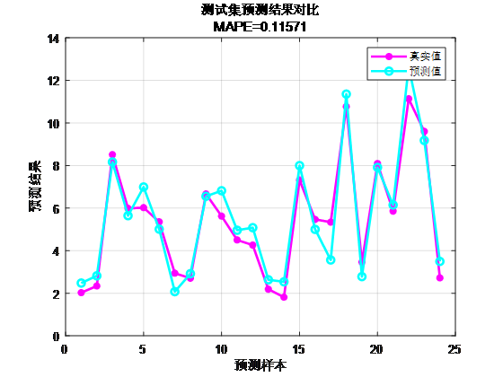
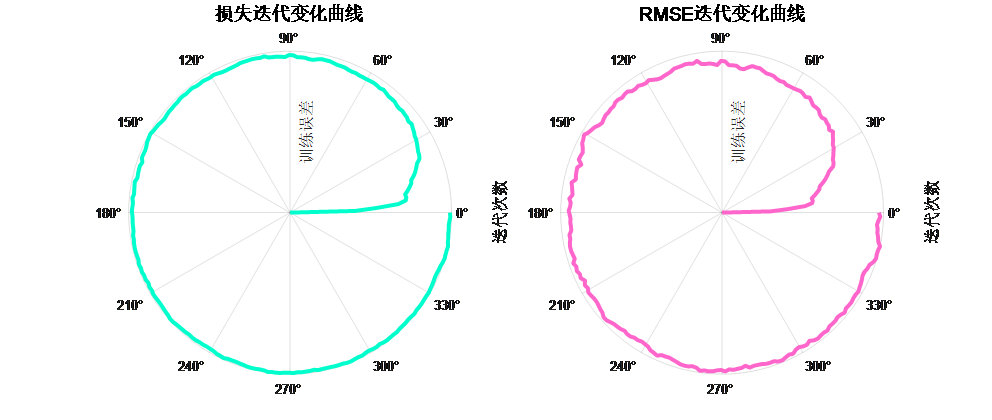
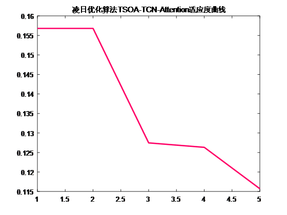

# TSOA-TCN-Attention Multivariate Regression Prediction Algorithm; Lunar Day Optimization Time Convolutional Neural Network Fusion with Multi-Head Self-Attention Mechanism for Multivariate Regression Prediction Program

Applicable Platform: MATLAB 2023 and above
TSOA-TCN-Attention Predictive Model with Excess 24 Steps, a Multivariate Regression Prediction Algorithm that integrates the Attention Mechanism with Time-Series Convolutional Neural Networks, using MATLAB code.
Introduction to TSOA: The Transit Search Optimization Algorithm (TSOA) is a novel metaheuristic algorithm introduced in 2023. It is named after the transit search method, which involves observing the dimming of a star's light when a planet passes in front of it, known as an eclipse. This algorithm, inspired by celestial physics, draws from the famous extraterrestrial planet exploration method, the transit search (TS). In the transit algorithm, by studying the light received from the star over a certain interval, changes in brightness are checked. If the amount of light received decreases, it indicates that the planet has passed in front of the star. Compared to algorithms such as Grey Wolf GWO, Whale WOA, Genetic GA, Particle Swarm PSO, etc., it demonstrates higher innovation.
Innovative aspects of the TCN-Multihead SelfAttention model:
Causal Expansion Convolution (Core feature of TCN): TCN addresses the limitations of traditional convolutional neural networks in processing time series data through causal expansion convolution. Causal expansion convolution enlarges the model's receptive field, allowing it to capture long-term dependencies while maintaining the temporal structure of the sequence data, ensuring the prediction of causality. This design not only improves prediction accuracy but also greatly enhances the model's ability to process long sequences.
Multi-head self-attention mechanism: The multi-head self-attention mechanism allows the model to process information in parallel across different subspaces, enabling it to simultaneously focus on different aspects and levels of the sequence. This mechanism enhances the model's understanding and capture of complex dynamics within the sequence, particularly suitable for tasks where features interact intricately.
The innovative framework combining TCN and self-attention: Combining the causal convolution of TCN with multi-head self-attention mechanism, the model leverages the advantages of TCN in handling temporal dependencies while utilizing the ability of self-attention to capture both long-term and complex dependencies in sequences. This combination is particularly effective in time series prediction, allowing for more accurate capturing and utilization of long-term and complex dependencies within sequences while maintaining the structure of the time series.

Functions:
- Multivariate feature input, single sequence variable output, input features from the previous day to make predictions for the next day, with a 24-step ahead prediction.
- Optimize learning rate, kernel size, number of neurons through the TSOA optimization algorithm, aiming for minimum MAPE as the objective function.
- Provide loss and RMSE iteratively changing polar coordinates; test comparison graphs; fitness curve (if the initial precision is highest, then the fitness curve is a horizontal line).
- Provide MAPE, RMSE, MAE, etc., for calculation results display.

Applicable fields: Prediction of wind speed, photovoltaic power, power generation, carbon price, etc.

Dataset format:
\n        \n      Function: Multivariate feature input, single sequence variable output, input features from the previous day to make predictions for the next day, with a 24-step ahead prediction, optimizes learning rate, kernel size, and number of kernels, aims for minimum MAPE as the objective function, displays MAPE, RMSE, MAE calculations. Suitable for applications such as wind speed prediction, photovoltaic power prediction, power generation prediction, outage prediction, offshore wind power prediction, carbon price prediction, etc.
18 meteorological features from the previous day, sampling time is 24 hours, output is the power output for the next day's 24 hours, which is 18×24 input, 1×24 output, there are 75 such samples.
Prediction vs. actual value comparison results:
\n        \n      Train error curve in polar coordinate form (error gradually approaching zero from inside to outside):
\n        \n      Fitness curve
\n        \n      Simply replace the data, directly importing it into an Excel sheet without significantly modifying the program. The program contains detailed comments for easy understanding of its operation.

## Images

<!-- PAYMENT_BLOCK -->

## Get this dataset

- Payment link (Stripe): [Buy now](https://buy.stripe.com/3cs8yP7sY87d0vu9AB)
- Payment QR code: 

<!-- /PAYMENT_BLOCK -->
